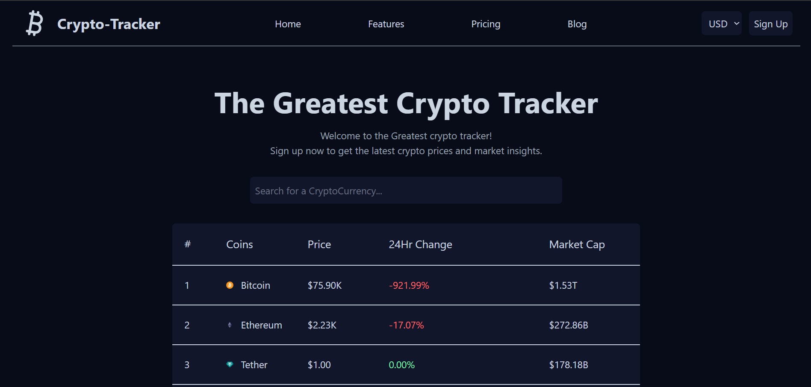
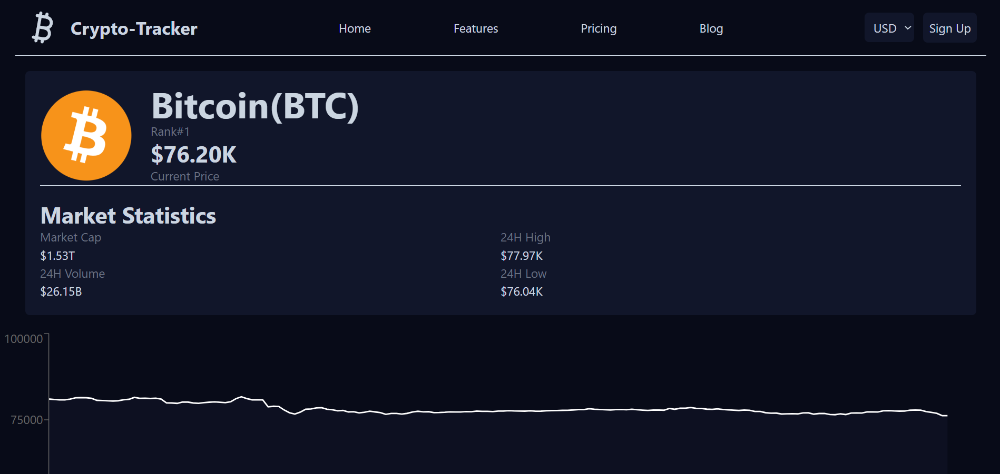

# Crypto Tracker

A responsive cryptocurrency tracking dashboard built with **React** and **Tailwind CSS** that displays cryptocurrency market data, prices, market trends, and detailed coin information using the CoinGecko Demo API.

## Live Demo

[Visit Crypto Tracker](https://crypto-tracker-git-main-red-x2.vercel.app/)


### Home Page


### Coin Details


## Features

- Live cryptocurrency market data
- Search for cryptocurrencies
- View current coin prices and market capitalization
- Explore interactive cryptocurrency price charts
- Switch between supported currencies
- Responsive user interface
- Navigate between pages using React Router

## Technologies Used

- **Frontend:** React, JavaScript
- **Styling:** Tailwind CSS v4
- **Routing:** React Router
- **Charts:** Recharts
- **Icons:** Lucide React
- **API:** CoinGecko Demo API
- **Build Tool:** Vite
- **Version Control:** Git & GitHub
- **Deployment & Hosting:** Vercel

## Installation and Setup

1. Clone the repository:

   ```bash
   git clone https://github.com/KishanShriVathsen/crypto-tracker.git
   ```

2. Navigate to the project directory:

   ```bash
   cd crypto-tracker
   ```

3. Install dependencies:

   ```bash
   npm install
   ```

4. Create a `.env` file in the root directory and configure your CoinGecko API credentials:

   ```env
   VITE_CRYPTO_API_KEY=your_api_key
   VITE_CRYPTO_API_URL=your_api_url
   VITE_CRYPTO_API_URL_GRAPH=your_graph_api_url
   ```

   **Note:** You need your own CoinGecko Demo API key. Never commit your actual `.env` file to GitHub.

5. Start the development server:

   ```bash
   npm run dev
   ```

## Limitations

- Uses the CoinGecko Demo API, which has request and rate limitations.
- Market data availability depends on the API.
- No backend implementation currently.
- No user authentication or personal portfolio management.

## Project Purpose

This project was developed to strengthen my practical knowledge of React, API integration, state management, routing, responsive design, and modern frontend development.

## Developer

**Kishan Shri Vathsen M**

- GitHub: [@KishanShriVathsen](https://github.com/KishanShriVathsen)

---

⭐ If you find this project interesting, feel free to explore the repository!
